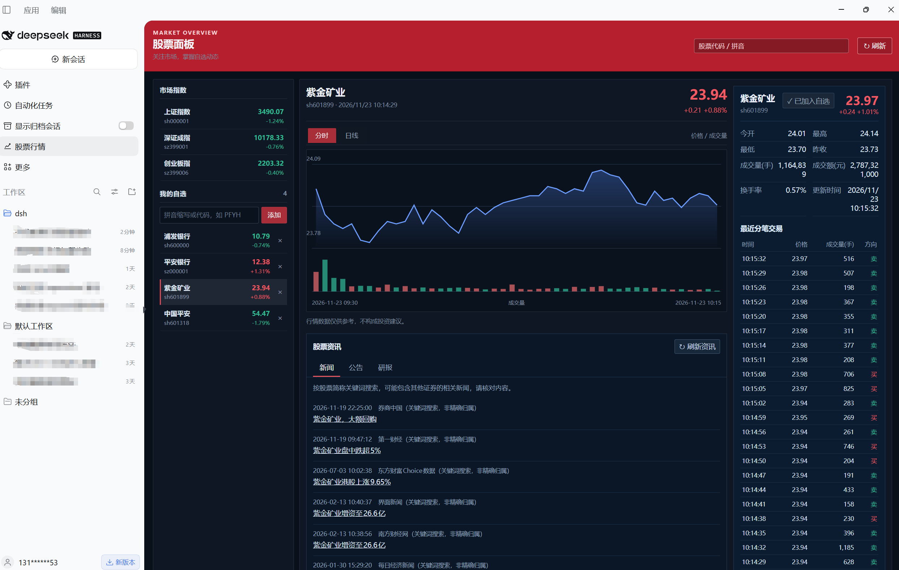
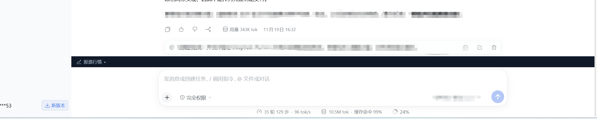
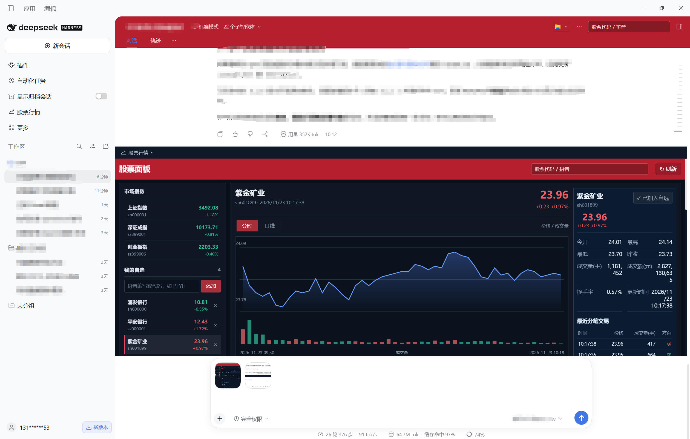

# 股票面板

股票面板是一个 DSH Web 插件，用于在宿主界面查看 A 股指数、自选证券报价、价格曲线、成交量、行情详情与相关资讯。它通过 DSH 宿主访问东方财富公开接口，不提供交易或投资建议；不保证与所有宿主版本兼容。

## 界面截图

### 股票面板



### 会话中的行情入口



### 会话中展开行情面板



## 环境与安装

- 需要支持 Web 客户端插件的 DSH；项目声明的版本范围为 `>=0.2.2-rc.1 <0.3.0-0`，Node.js 要求 `>=22.15`。实际兼容性请在目标宿主验证。
- 发布到 npm 后，在 DSH Web「插件」页选择「添加插件」，输入 `dsh-stock-panel` 并安装、启用。也可以输入本项目目录的绝对路径，安装本地副本。
- 刷新当前页面。在左侧导航选择「股票行情」打开完整面板；也可在会话输入框上方点击「股票行情」，展开紧凑面板。紧凑面板使用宿主输入区插槽，位置在输入框上方。
- 如看不到入口或加载失败，请检查插件是否启用、路径、宿主版本与联网情况；上游接口及宿主兼容性均可能变化。

## 指数、自选与搜索

左栏固定显示上证指数、深证成指和创业板指。首次使用默认自选浦发银行（`sh600000`）和平安银行（`sz000001`）；点击列表中的证券切换查看，点击自选项旁的 `×` 删除。删除当前选中的非指数证券后会回到上证指数。

- 在自选栏输入拼音首字母（如 `PFYH`）或六位代码，选择候选即可添加；也可以输入完整的市场前缀代码（如 `sh600000`、`sz000001`、`bj430047`），点击「添加」。格式要求为 `sh`、`sz` 或 `bj` 加六位数字；格式正确不代表该证券一定存在或有数据。
- 搜索输入须为 1 至 12 位英文字母或数字，搜索源最多返回前 10 条，再筛选沪 A、深 A、京 A 候选；可能没有匹配结果。上下方向键选择候选，回车确认，Esc 关闭候选。
- 会话页眉或面板顶部也可搜索并选择证券直接查看，**不会自动加入自选**；完整前缀代码也可直接回车查看。查看后可用右侧「添加自选」加入。
- 固定指数与自选合计最多 30 个不同代码，重复添加会提示。自选保存在当前浏览器该站点的 localStorage，不会跨浏览器或站点地址自动同步；清除浏览器数据可能丢失，保存失败时界面会提示。

## 曲线与行情详情

点击指数或自选项后，在「分时」和「日线」之间切换。分时请求一天的数据；日线请求最近最多 100 个交易日，使用不复权价格。图中是价格折线及成交量柱，日线绘制收盘价，**不是 K 线蜡烛图**。价格涨跌采用红涨绿跌。成交量柱按相邻价格变化着色。

点击、拖动或轻触图表，或将图表聚焦后使用方向键选择数据点，可查看时间、价格和成交量。曲线成交量显示上游原始数值，其单位可能随品种不同，界面标注来源单位待确认，不宜直接跨品种比较。无数据或请求失败时会显示提示。

右侧行情详情展示名称、代码、价格、涨跌、今开、最高、最低、昨收、成交量（手）、成交额（元）、换手率和更新时间，以及最多最近 50 条分笔的时间、价格、成交量（手）和方向。分笔方向是数据源的主动买卖分类，并非资金流入或流出的保证；指数等品种可能没有分笔，字段也可能缺失。窄屏时详情可能排到曲线下方。

## 资讯、公告与研报

图表下方提供「新闻」「公告」「研报」三个分类，切换证券或点击「刷新资讯」会重新请求。每类请求最多 20 条，数据可能为空、部分失败或不完整；各分类独立显示错误。公告和研报会按代码及市场等字段校验，链接指向东方财富相关页面或 PDF。

**新闻是关键词搜索，不是证券身份精确匹配。** 插件先获取并核对证券简称，再以简称搜索；简称少于 3 个或超过 40 个字符、含不允许的字符，或属于代码中列出的过于泛化名称时，会停止新闻搜索并提示。只保留标题或正文包含该简称且链接符合限定格式的结果，但仍可能混入其他证券报道。上游先按相关性返回，插件仅对返回结果按日期排序，不能保证最新、完整或准确；请打开原文自行核对。点击资讯链接会在新标签页打开第三方网站。

## 数据源、权限与隐私

行情、走势、搜索和资讯由 DSH 宿主向东方财富公开接口发起联网请求；代码、搜索关键词及新闻搜索使用的证券简称会发送给该服务商，网络服务商也可能获得常规连接信息。点击外部资讯链接后，浏览器会直接访问对应第三方站点，其隐私政策适用。插件不要求在界面输入证券账户或密码，也不提供下单功能。

本插件使用宿主的连接服务注册固定用途的行情接口，以及 Web 布局和插槽显示界面；它不是通用网络代理。自选保存在浏览器本地，而不是插件提供的云端同步服务。使用前请自行评估宿主、网络环境和第三方数据服务的权限及隐私风险。

## 刷新、缓存与限制

- 面板顶部「刷新」重新请求列表报价、当前曲线、详情和资讯；切换证券或周期也会请求相应数据。右侧详情在面板打开期间约每 30 秒自动刷新；列表报价和曲线没有定时自动刷新。
- 服务端对报价、曲线及详情上游数据缓存 15 秒，并合并相同的并发请求；因此短时间内手动刷新不一定得到新数据。搜索、公告、研报和新闻搜索结果不使用这一缓存，但新闻所需的简称报价可能命中缓存。缓存保存在宿主进程内，不是持久存储。
- 上游请求超时约 8 秒。接口可能限流、延迟、变更或不可用，数据也可能缺失、错误或不是实时的；非交易时段可能显示最近可用行情。部分失败时其他可用部分仍可能显示。
- 搜索和代码格式校验不保证覆盖全部品种；资讯结果数量、排序与准确性受上游和过滤规则限制。请勿依赖本插件进行实时交易、自动交易或关键决策。

## 测试

在项目目录运行：

```powershell
node --test test/*.test.cjs
```

或运行 `npm test`。测试覆盖行情后端、曲线、页眉搜索与资讯相关逻辑；通过测试不等于已经验证实际上游可用性、宿主安装或所有浏览器兼容性。

## 安全警示

行情和资讯仅供参考，不构成投资建议、证券推荐或收益承诺。投资有风险，请以交易所、上市公司公告及合规机构信息为准，独立核实价格、时间、单位和新闻归属。不要向插件或资讯链接输入账户密码、验证码等敏感信息；打开第三方链接和 PDF 前请核对来源并注意网络安全。
